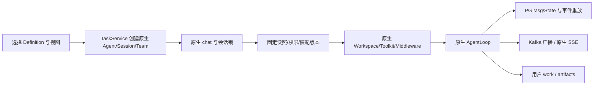

# V1 实现与验收

2026-11-04。本机使用 Python 3.11.9、AgentScope 2.0.11、PG 17、Nacos 3.3、Kafka 3.8。启动命令与登录说明见 [README](../README.md)。

## 已交付

| 项目 | 内容 |
| --- | --- |
| framework | Definition、User/Group、Agent/Team、USE 路径、共享审核、版本包、原生 Storage 增量、Workspace/资源/ReMe 适配 |
| app | 原生 create_app 主应用、薄 Controller、可信身份、Nacos 配置、显式迁移/初始化、原生接口封口 |
| frontend | Vue3/TDesign 独立组件；左导航与任务，中间聊天与专家/技能/连接器，右侧工作区及产物预览；共享和管理员页面 |
| Demo | 1.0.0/1.1.0 发布目录、原生工具/middleware/Skill、真实 MCP、六个系统专家和一个固定团 |
| Nacos | 三个配置文件，Skill egis-demo-report 和 MCP egis-demo-tools 的真实 1.0.0 案例 |
| MessageBus | standalone 委托 InMemory；cluster 采用 Kafka 消费组唤醒/广播与 PG 状态/CAS/租约 |

没有复制 ChatService、AgentLoop 或 SSE。原生仓库仅保留用户已有的 `workspace/_sandboxed_base.py` 修改。



新建任务分配独立 Session；每轮在原生会话锁内检查当前授权和可用性。独立 Agent 后续轮次读取最新 Definition，HITL 与固定 Team 保留快照；每个成员只装配自己的绑定。新包先暂存校验再注册，其他实例下一次装配按 PG 固定摘要加载，正在使用的旧对象保留。

系统登记默认无 USE；私有轻量资源按预设规则自用，只有共享需审核。共享冻结完整闭包，新建共享资源边必须匹配审核的精确版本、归属和摘要。

## 验证命令与证据

工作区根目录：

```sh
EGIS_BUS_INTEGRATION=1 AGENTKIT_RESOURCE_LIVE_NACOS=1 demo/agentscope-demo/.venv/bin/python -m pytest egis/egis-agentkit-framework/tests -q --tb=short
demo/agentscope-demo/.venv/bin/python egis/egis-agentkit-app/scripts/verify_live.py --check-hitl --check-stop
demo/agentscope-demo/.venv/bin/python egis/egis-agentkit-app/scripts/verify_team.py
```

最终后端全量 **125 passed in 129.79s**，真实 Nacos/Kafka 选项均开启，无跳过。包含 Agent/用户缓存目录与并发首次物化回归。Ruff 检查通过。PG 测试各有临时 schema，Kafka 测试各有独立 topic。前端 `npm test` **15 passed**，浏览器 **9 passed**，构建成功，audit **0 vulnerabilities**；主 chunk 约 715 kB 的提示仍保留。

- [真实聊天](真实聊天验收.json)：报告实际交付；人工确认后同一 reply 续跑；Kafka 取消后原生 interrupted。
- [真实专家团](真实专家团验收.json)：主理人两轮、专家一轮，完成 TeamSay → Kafka → 专家 → 主理人的往返；历史以原生持久化 Msg 为准，checkpoint 会裁剪重放日志。
- [真实页面](../../egis-agentkit-frontend/docs/真实后端页面验收.md)：PG 目录、专家/固定团详情、创建/共享/审核、三栏历史与产物、窄屏截图。
- [Nacos](../../egis-agentkit-framework/docs/Nacos验收.md)、[发布包](../../egis-agentkit-framework/docs/发布包验收.md)、[MessageBus](../../egis-agentkit-framework/docs/MessageBus验收.md) 有分项结果。

独立复核发现的问题均已补回归并复核修复，见 [复核记录](reviews/final-review.md)：版本闭包覆盖、MCP 端点漂移、共享跨版本越权、Hub latest 绕过、装配失败无结束事件及成员失败未通知主理人。

## 首版边界

- Workspace 使用 local；OpenSandbox 已安装，NAS/Sandbox Adapter 尚未实现，选择 sandbox 会明确启动失败。local 不提供 OS 隔离。
- ReMe 默认关闭；原生中间件已验证启动/关闭，未验证真实记忆写入/检索或多进程同用户目录并发，见 [ReMe 接入](../../egis-agentkit-framework/docs/ReMe接入.md)。
- 连接器管理首版支持无明文凭据的 streamable HTTP；认证凭据绑定及其他运行协议尚未接入管理链路。
- Kafka 保留原生 drain/spawn ACK 窗口，未实现业务完成 ACK、自动 DLQ、外部 fencing 或整轮跨进程 Worker，不承诺业务 exactly-once。
- 当前 Nacos 开发 console 原本关闭认证；未修改其设置。正式环境需配置组织认证的管理 API、公司 RS256/JWKS 身份和部署证书。容量、网络分区与 OS 级崩溃未完成生产验收。
- 早期测试异常曾在工具输出带出本地 PG 密码，未写入新源码或交付文档。已修正凭据解析并隐藏 SQL 参数；历史输出无法撤回，应轮换开发凭据。没有擅自更改共享数据库密码。

最终启动复验：App 与前端均返回 200；readiness 为 cluster、MessageBus ready、Nacos connected、配置批次 1。最新代码重启后再次通过真实聊天/确认/停止与浏览器历史/文件检查。

## 2026-11-05 界面复用与新增记录

已复用 `demo/workbuddy-web` 的界面结构与样式，完成组件拆分、CSS 提取、深浅主题与真实接口适配。权限模式移至输入框左下；五项能力目录与按钮、图标标准库、历史对话重命名、PG 文件变更记录已接通。验证结果与接口/扫描范围见 [本轮实施记录](2026-11-05-WorkBuddy复刻实施记录.md)。
